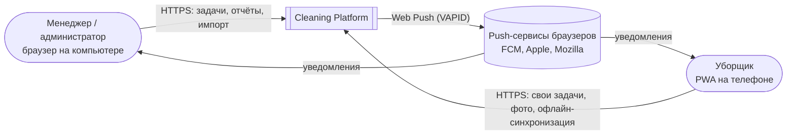
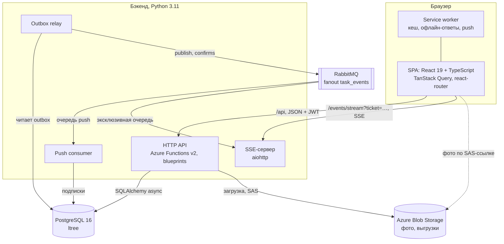
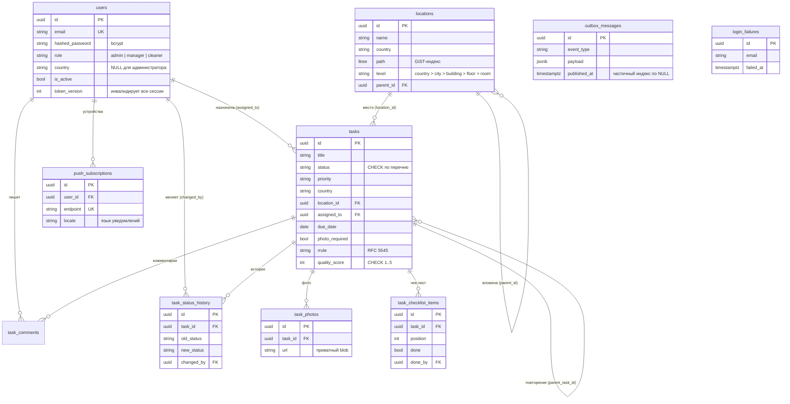
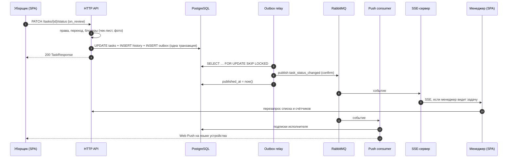
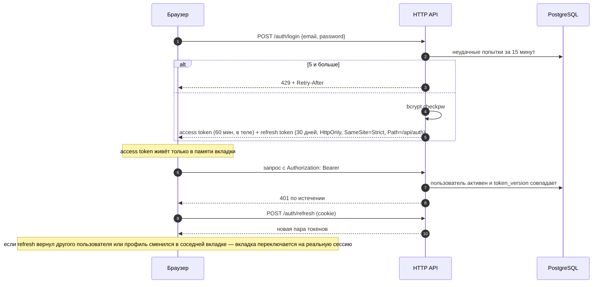
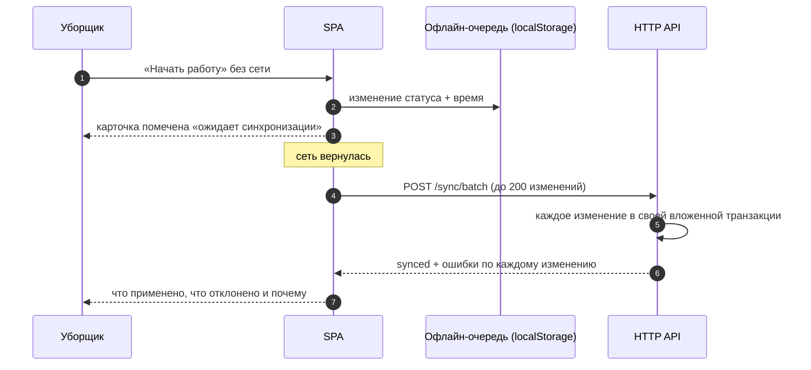
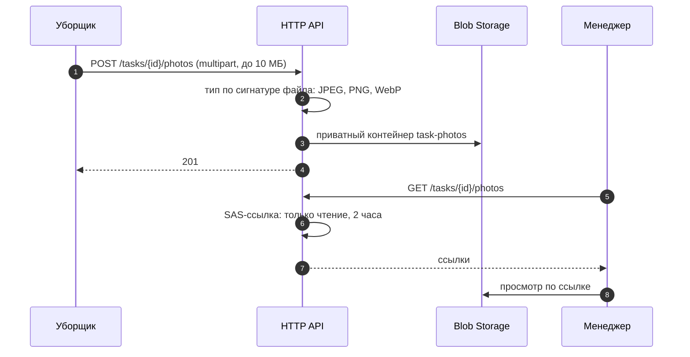
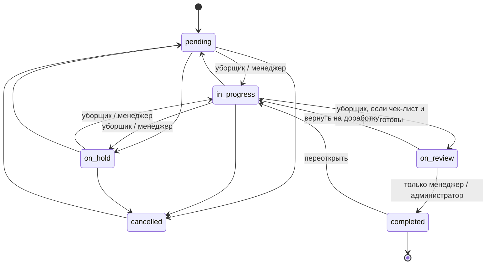

# Архитектура

Платформа управляет задачами по уборке в нескольких странах: менеджеры создают и проверяют задачи, уборщики выполняют их с телефона, в том числе без связи.

## Роли

| Роль | Видит | Может |
|---|---|---|
| Администратор | все страны | всё, включая пользователей, локации и пароли |
| Менеджер | задачи и локации своей страны | создавать, назначать, принимать и оценивать задачи своей страны, импорт и экспорт |
| Уборщик | только назначенные ему задачи | брать в работу, отмечать чек-лист, загружать фото, отправлять на проверку |

Права проверяются на сервере в каждом запросе (`src/domain/services/task_access.py`); интерфейс только скрывает недоступные действия.

## Контекст

## Контейнеры

| Контейнер | Ответственность | Код |
|---|---|---|
| HTTP API | REST-эндпоинты, авторизация, валидация, бизнес-правила, запись событий в outbox в той же транзакции | `function_app.py`, `src/api/` |
| Outbox relay | Пачками по 100 забирает неопубликованные события (`FOR UPDATE SKIP LOCKED`), публикует с подтверждением, отмечает `published_at` | `src/infrastructure/messaging/relay.py` |
| Push consumer | Из очереди решает, кого уведомить, рендерит текст на языке устройства, отправляет Web Push, удаляет протухшие подписки | `src/infrastructure/messaging/consumer.py` |
| SSE-сервер | Пускает по одноразовому билету на 30 секунд (`POST /events/ticket`), держит открытые соединения и рассылает события только тем, кто имеет право видеть задачу | `sse_server.py`, `src/api/events.py` |
| SPA | Интерфейс, кеш серверного состояния, URL как источник фильтров, офлайн-очередь уборщика | `cleaning-frontend/src/` |
| Service worker | Кеш оболочки приложения, офлайн-ответ API, показ push и открытие задачи по клику | `cleaning-frontend/public/sw.js` |

Слои бэкенда: `src/api` (транспорт и сценарии) → `src/domain` (модели, правила доступа, разбор импорта, локации, без зависимостей от инфраструктуры) ← `src/infrastructure` (БД, очередь, хранилище, push, JWT). Тексты на двух языках — `src/translations`.

## Данные

Схема ведётся миграциями Alembic (`cleaning-platform/migrations/versions`), каждая с откатом. Инварианты закреплены в БД: уникальный email и endpoint, CHECK на статус, приоритет и оценку, каскадное удаление фото, чек-листа, комментариев и истории вместе с задачей.

## Ключевые потоки

### Смена статуса и уведомления

Событие записывается в той же транзакции, что и изменение, поэтому падение очереди не теряет уведомления, а откат транзакции не рассылает несуществующих изменений (подробнее — ADR-001).

### Вход и сессия

Выход, деактивация, смена роли или страны и сброс пароля увеличивают `token_version`: все выданные токены пользователя перестают работать сразу (ADR-003).

### Офлайн-работа уборщика

Изменение отклоняется, если задачу изменили на сервере позже офлайн-изменения или переход недопустим; остальные применяются.

### Фото результата

## Статусы задачи

Уборщику доступны только четыре перехода: `pending → in_progress`, `in_progress → on_review`, `in_progress ↔ on_hold`. Принять задачу может только менеджер её страны или администратор.

## Развёртывание локально

`python3 start.py` поднимает PostgreSQL, RabbitMQ и Azurite в Docker (порты открыты только на `127.0.0.1`), накатывает миграции и запускает API, SSE-сервер, relay, consumer и Vite. Vite проксирует `/api`, `/events` и `/blob`, поэтому браузер работает с одним origin.
