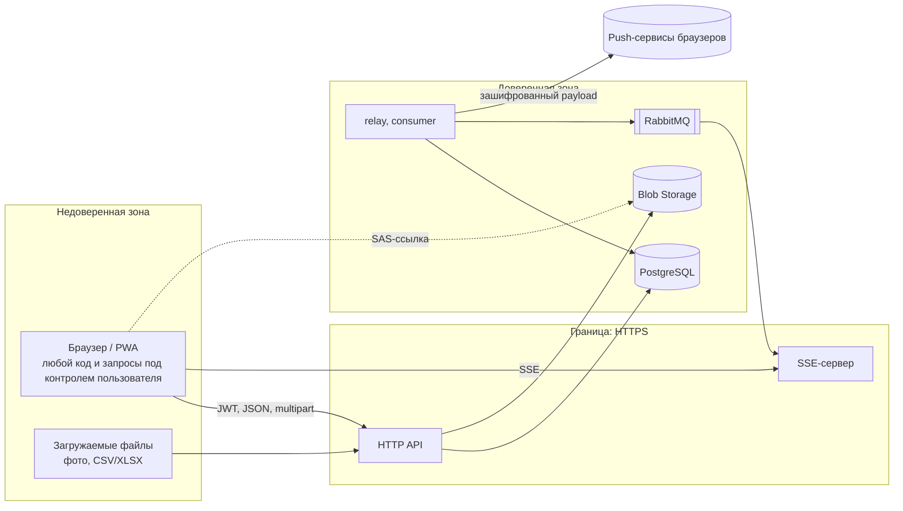

# Модель угроз

Анализ по методике STRIDE: что защищаем, от кого, где проходят границы доверия, какие угрозы закрыты и какие риски остаются.

## Активы

| Актив | Почему ценен |
|---|---|
| Учётные записи и сессии | дают действовать от имени менеджера или администратора |
| Данные задач, комментарии, история | рабочая информация компании, отчётность |
| Фото результата | могут содержать помещения и людей |
| Персональные данные | email сотрудников, их страна, кто и когда что делал |
| Ключи и секреты | JWT-секреты, приватный VAPID-ключ, ключ хранилища, строка подключения к БД |
| Целостность приёмки | оценка качества и статус «выполнена» — основа контроля работы |

## Нарушители

| Нарушитель | Возможности |
|---|---|
| Внешний анонимный | доступ к публичному адресу, перебор паролей, сканирование |
| Уборщик | валидная учётка с минимальными правами, полный контроль над своим устройством и запросами |
| Менеджер чужой страны | валидная учётка с правами в другой стране |
| Посторонний с устройством | доступ к разблокированному телефону или общему компьютеру |

## Границы доверия

Всё, что приходит из браузера, включая заголовки, тело, параметры URL, файлы и офлайн-очередь, считается недоверенным. Права проверяются на сервере в каждом запросе. Скрытая кнопка в интерфейсе ничего не защищает.

## Угрозы и меры (STRIDE)

### S — подмена субъекта

| Угроза | Мера | Где |
|---|---|---|
| Перебор паролей | 5 неудач за 15 минут на email → `429` с `Retry-After`; счётчик в БД общий для всех инстансов; неизвестные email считаются так же | `src/api/auth.py`, `login_throttle.py`, ADR-008 |
| Кража хешей паролей | bcrypt с солью | `src/infrastructure/auth/jwt_handler.py` |
| Кража access-токена через XSS | токен только в памяти вкладки; React экранирует вывод, сырого HTML нет | ADR-003 |
| Кража refresh-токена | cookie `HttpOnly; SameSite=Strict; Path=/api/auth`, `Secure` вне локальной разработки | `src/api/auth.py` |
| Подделка токена | HS256 с секретом из окружения; обязательные `sub`, `exp`, `type`; access и refresh нельзя подменить друг другом | `jwt_handler.py` |
| Использование токена после выхода, деактивации или сброса пароля | `token_version` сверяется с БД в каждом запросе и увеличивается при этих событиях | `src/infrastructure/auth/middleware.py` |
| Самостоятельная регистрация администратора | открытая регистрация удалена, учётки создаёт только администратор | `src/api/users.py` |
| Вкладка действует под чужим аккаунтом после входа в соседней | вкладка переключается на пользователя, которого вернул refresh, и следит за входом и выходом в других вкладках | `cleaning-frontend/src/auth/` |

### T — подмена данных

| Угроза | Мера | Где |
|---|---|---|
| SQL-инъекция | только параметризованные запросы SQLAlchemy; поиск экранирует `%`, `_`, `\`; сортировка по белому списку колонок | `src/api/http.py` (`like_pattern`), `task_queries.py` (`SORT_COLUMNS`) |
| Уборщик сам принимает свою задачу | уборщику доступны только 4 перехода; «выполнена» — только менеджер страны или администратор; одни и те же правила в API, SSE и синхронизации | `task_access.py`, ADR-005 |
| Отправка на проверку без работы | блокеры: незавершённый чек-лист, нет обязательного фото | `task_access.review_blockers` |
| Изменение задач чужой страны (IDOR) | задача загружается через проверку видимости; чужая отвечает 404, а не 403, чтобы не раскрывать её существование | `task_queries.load_visible_task` |
| Офлайн-изменение затирает решение менеджера | изменение отклоняется, если задачу изменили на сервере позже | `src/api/sync.py`, ADR-006 |
| Подмена файла под видом фото | тип определяется по сигнатуре (JPEG, PNG, WebP), а не по имени или `Content-Type`; до 10 МБ | `src/domain/services/photos.py` |
| Вредоносный импорт | до 5 МБ и 5000 строк, каждая строка валидируется; исполнитель — только активный уборщик страны; сначала предпросмотр без записи | `src/api/import_tasks.py`, `task_import.py` |
| Нарушение инвариантов данных | ограничения в БД: уникальный email и endpoint, CHECK на статус, приоритет и оценку 1–5, внешние ключи | миграции |

### R — отказ от действий

| Угроза | Мера | Где |
|---|---|---|
| «Это не я поменял статус» | каждая смена статуса пишется в историю с автором и временем | `task_status_history` |
| «Я не отмечал пункт» | у пункта чек-листа хранятся `done_by` и `done_at` | `task_checklist_items` |
| Спор об оценке | хранятся оценивший и время оценки | `tasks.quality_reviewed_by`, `quality_reviewed_at` |

### I — раскрытие информации

| Угроза | Мера | Где |
|---|---|---|
| Доступ к фото посторонних | приватный контейнер, ссылки SAS только на чтение и на 2 часа, выдаются только тем, кто видит задачу | ADR-004 |
| События чужих задач по SSE | событие уходит только тем, кто может видеть задачу, включая прежнего исполнителя при переназначении | `sse_server.can_receive` |
| Утечка внутренних ошибок | на 500 клиент получает общее сообщение, детали только в логе сервера | `src/api/http.py` |
| Секреты в репозитории | `.env`, `local.settings.json` и `*.pem` в `.gitignore`; ранее закоммиченный VAPID-ключ удалён и ротирован; VAPID передаётся контейнеру как секрет compose | `.gitignore`, `docker-compose.yml` |
| Сервисы торчат в сеть | PostgreSQL, RabbitMQ, Azurite, API и SSE слушают только `127.0.0.1` | `docker-compose.yml` |
| Перечисление email через вход | одинаковый ответ и одинаковый счётчик для существующих и неизвестных email | `src/api/auth.py` |

### D — отказ в обслуживании

| Угроза | Мера | Где |
|---|---|---|
| Огромные файлы | фото до 10 МБ, импорт до 5 МБ; чтение с ограничением размера | `task_activity.py`, `import_tasks.py` |
| Тяжёлые выборки | пагинация с ограниченным размером страницы; поиск не длиннее заданного; периоды отчёта и выгрузки ограничены; индексы под фильтры и сортировку | `src/api/tasks.py`, `stats.py`, `export.py` |
| Огромная пачка синхронизации | не больше 200 изменений за запрос | `src/api/sync.py` |
| Медленный SSE-клиент копит события | очередь на клиента ограничена 100 сообщениями, лишние отбрасываются | `sse_server.py` |
| Падение очереди теряет уведомления | outbox: событие ждёт в БД до успешной публикации | ADR-001 |

### E — повышение привилегий

| Угроза | Мера | Где |
|---|---|---|
| Доступ к эндпоинтам без входа | все маршруты, кроме входа, обновления, выхода, публичного VAPID-ключа и документации, требуют токен; тест перебирает все зарегистрированные маршруты | `tests/unit/test_route_access.py` |
| Менеджер или уборщик управляет пользователями и локациями | эндпоинты только для администратора; тесты на 403 для каждой роли | `tests/integration/test_admin_management.py` |
| Администратор лишает себя прав по ошибке | нельзя менять свою роль и страну, деактивировать себя, сбрасывать себе пароль через админку | `src/api/users.py` |
| Уборщик перестаёт видеть задачи, оставаясь их исполнителем | смена страны или роли уборщика запрещена, пока у него есть открытые задачи | `src/api/users.py` |

## Соответствие OWASP Top 10 (2021)

| Категория | Состояние |
|---|---|
| A01 Нарушение контроля доступа | проверка прав на каждом запросе, IDOR закрыт видимостью задачи, тесты по ролям |
| A02 Криптографические сбои | bcrypt, HS256 с секретами из окружения, SAS-подпись хранилища, TLS на периметре |
| A03 Инъекции | параметризованный SQL, экранирование `LIKE`, белый список сортировки, React без сырого HTML |
| A04 Небезопасный дизайн | границы доверия описаны, ограничения размеров и количеств, outbox, отказ по умолчанию |
| A05 Небезопасная конфигурация | сервисы на `127.0.0.1`, нет открытой регистрации; CSP пока не задана — см. риски |
| A06 Уязвимые компоненты | зафиксированные версии зависимостей, `npm audit` без уязвимостей |
| A07 Сбои аутентификации | ограничение попыток, отзыв сессий через `token_version`, refresh только в HttpOnly-cookie |
| A08 Нарушение целостности | подпись токенов, проверка типа файлов по сигнатуре, lock-файлы зависимостей |
| A09 Логирование и мониторинг | логируются неудачные входы и блокировки без email и паролей; централизованного мониторинга пока нет |
| A10 SSRF | сервер не ходит по адресам, полученным от пользователя; push идёт только на endpoint из подписки по HTTPS |

## Остаточные риски

Известные ограничения с оценкой и рекомендацией. Они сознательно не закрыты в текущей версии.

| # | Риск | Оценка | Рекомендация |
|---|---|---|---|
| R1 | SSE-сервер принимает access-токен в query-строке (`EventSource` не умеет заголовки). URL с токеном может попасть в логи прокси и историю | средний: токен живёт 60 минут, SSE за тем же origin | одноразовый короткий тикет на подключение (`POST /events/ticket` → `?ticket=…` на 30 секунд) |
| R2 | После выхода кеш задач уборщика и офлайн-очередь остаются в `localStorage` устройства (функция очистки есть, но не вызывается) | низкий: данные привязаны к пользователю и не показываются другим, но читаются с разблокированного устройства | очищать кеш при выходе, а несинхронизированные изменения отправлять или явно предупреждать о них |
| R3 | Не задана Content-Security-Policy | низкий: нет сырого HTML и сторонних скриптов | `default-src 'self'`, `connect-src` на API и push, `img-src` на хранилище — на уровне веб-сервера или CDN |
| R4 | Нет ограничения запросов по IP; блокировка по email позволяет на 15 минут закрыть вход чужому аккаунту | средний | rate limiting на шлюзе (Azure Front Door / API Management), CAPTCHA после нескольких неудач |
| R5 | SAS-ссылку на фото можно переслать, и она работает до 2 часов | низкий | сократить срок или выдавать ссылки на отдельный просмотр |
| R6 | Число SSE-подключений не ограничено | низкий за аутентификацией | лимит подключений на пользователя и общий |
| R7 | Тестовые учётки из `seed.py` с простыми паролями | только для разработки | не запускать `seed.py` в продуктиве, ротировать пароли демо-стенда |
| R8 | Временный туннель (localhost.run, trycloudflare) открывает dev-стенд в интернет | только на время теста | держать туннель только на время проверки, не использовать с реальными данными |
| R9 | XLSX разбирается без `defusedxml` | низкий: стандартный парсер Python не загружает внешние сущности, файл ограничен 5 МБ | установить `defusedxml`, тогда openpyxl будет использовать его автоматически |
